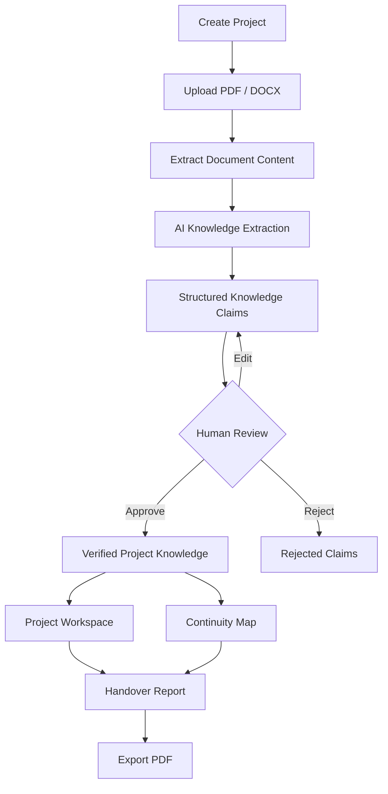
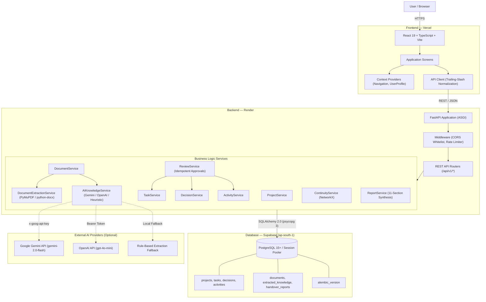
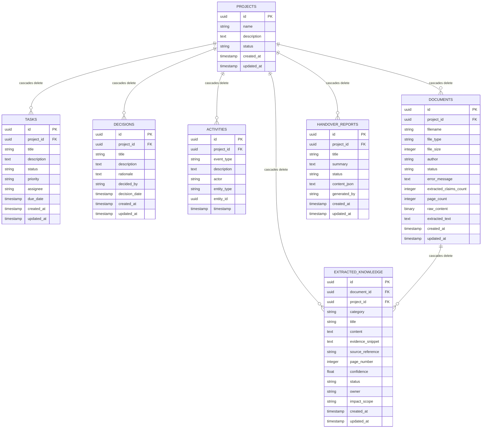
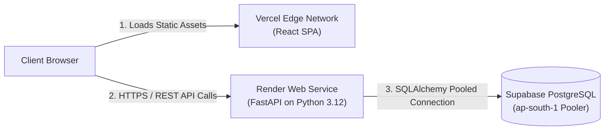

# Threadline

**Never lose the context behind the work.**

[](https://www.python.org/)
[](https://fastapi.tiangolo.com/)
[](https://react.dev/)
[](https://www.typescriptlang.org/)
[](https://supabase.com/)
[](https://vitejs.dev/)

Threadline is an AI-powered project knowledge continuity and handover platform that captures, reconstructs, verifies, and organizes project knowledge so teams can transition ownership without losing decisions, rationale, progress, dependencies, risks, or critical context.

- **Live Application:** [https://threadline-mauve-phi.vercel.app](https://threadline-mauve-phi.vercel.app)
- **Backend API:** [https://threadline-api-gefb.onrender.com](https://threadline-api-gefb.onrender.com)
- **Interactive API Documentation (Swagger):** [https://threadline-api-gefb.onrender.com/docs](https://threadline-api-gefb.onrender.com/docs)
- **ReDoc API Documentation:** [https://threadline-api-gefb.onrender.com/redoc](https://threadline-api-gefb.onrender.com/redoc)
- **GitHub Repository:** [https://github.com/Aaryan-2903/Threadline](https://github.com/Aaryan-2903/Threadline)

---

## Table of Contents

1. [Problem Statement](#problem-statement)
2. [The Threadline Solution](#the-threadline-solution)
3. [Core Workflow](#core-workflow)
4. [Implemented Features](#implemented-features)
5. [User Interface & Screenshots](#user-interface--screenshots)
6. [System Architecture](#system-architecture)
7. [Technology Stack](#technology-stack)
8. [Database Design](#database-design)
9. [Repository Structure](#repository-structure)
10. [Local Development Setup](#local-development-setup)
11. [API Documentation](#api-documentation)
12. [Testing and Quality Assurance](#testing-and-quality-assurance)
13. [Deployment Architecture](#deployment-architecture)
14. [Security Considerations & Limitations](#security-considerations--limitations)
15. [Team ALT-F4](#team-alt-f4)
16. [Roadmap — Planned Round 3 Capabilities](#roadmap--planned-round-3-capabilities)
17. [License & Acknowledgements](#license--acknowledgements)

---

## Problem Statement

Engineering teams operate in high-velocity environments where institutional knowledge degrades rapidly across team transitions:

- **Fragmented Project Context:** Knowledge is scattered across unstructured architecture decision records (ADRs), pull requests, issue trackers, design specifications, meeting notes, and private chat channels.
- **Context Loss During Turnover:** When key contributors, tech leads, or architects leave a project, their implicit knowledge and the underlying rationale for architectural decisions vanish with them.
- **Task Trackers Are Insufficient:** Traditional project management software (such as Jira, Linear, or Trello) tracks the operational state of tasks ("Done", "In Progress"), but systematically fails to record why specific architectural trade-offs, constraints, or rejected alternatives were chosen.
- **Handover Debt:** Manual handover documents are written hurriedly during notice periods. They quickly become stale, lack source citations, fail to map interdependencies, and force incoming engineers into painful archaeology through months of commit history.

---

## The Threadline Solution

Threadline transforms unstructured project documentation into an interconnected, evidence-backed, human-verified knowledge base.

Rather than competing with issue trackers, Threadline acts as the continuity layer for technical projects:

- **Evidence-Backed Knowledge Extraction:** Uploaded technical artifacts (PDFs, DOCX specifications) are parsed into structural text chunks and analyzed by AI models to extract candidate decisions, tasks, risks, questions, and conflicts.
- **Human-in-the-Loop Verification:** Machine-extracted knowledge is never accepted blindly. Claims are staged in an AI Review Queue where human domain experts review extracted evidence snippets and source page citations before promoting them to verified project records.
- **Continuity Graphing:** Instead of flat task lists, Threadline constructs a relational Continuity Map that visualizes how architectural decisions unblock specific tasks, which team members own critical paths, where orphan nodes exist, and where blocking dependencies threaten project velocity.
- **Automated Handover Reports:** With a single action, Threadline synthesizes all verified project assets into an 11-section executive and technical handover report complete with explicit incoming owner assignment and one-click PDF export.

---

## Core Workflow

Threadline guides engineering teams through a rigorous 5-stage knowledge continuity lifecycle:

1. **Capture:** Create a designated project workspace and upload source specifications, design documents, or meeting notes in PDF or DOCX formats.
2. **Reconstruct:** The backend extraction pipeline extracts clean structural content and uses configured AI models (or deterministic heuristic parsers) to extract categorized claims with source page references.
3. **Verify:** Candidate claims appear in the AI Review Queue with confidence scores, category badges, extracted evidence text, and exact document page citations.
4. **Review:** Engineering leads approve, edit, or reject claims individually or in batch. Approved claims are atomically promoted to official Project Tasks or Decisions, while rejected claims are recorded for auditability without cluttering project state.
5. **Handover:** The team explores the relational Continuity Map to identify architectural blockers and unassigned tasks, assigns incoming successors, and exports comprehensive handover documentation as a clean PDF artifact.



---

## Implemented Features

Every feature listed below is fully implemented and operational in the codebase:

### Project Management
- Full project CRUD with unique identifiers (`UUIDv4`), names, descriptions, and statuses (`active`, `archived`).
- Project deletion with database-level cascading deletion across all associated child records (tasks, decisions, documents, activities, claims, and reports).

### Task & Decision Tracking
- **Tasks:** Scoped to projects or global workspace. Tracks title, description, priority (`low`, `medium`, `high`, `urgent`), status (`todo`, `in_progress`, `done`, `blocked`), assignee, and due dates.
- **Decisions (ADRs):** Records title, description, detailed rationale, decider, and formal decision date.
- Input validation: Pydantic schemas enforce bounds on all user inputs (titles: 1-200 characters, descriptions/rationales: up to 10,000 characters).

### Document Ingestion & Safe Parsing
- **PDF Extraction:** Validates binary `%PDF-` signature. Extracts text page-by-page using PyMuPDF (`fitz`), computing page counts and paragraph markers.
- **DOCX Extraction:** Validates `PK\x03\x04` signature and XML structure (`[Content_Types].xml`, `word/document.xml`) using `python-docx`.
- **ZIP-Bomb & Decompression Protection:** Enforces strict archive safety limits:
  - Maximum archive entries: 1,000
  - Maximum total uncompressed size: 50 MB
  - Maximum single entry size: 20 MB
  - Maximum compression ratio: 100:1 (rejects decompression bombs)
  - Rejection of encrypted/password-protected ZIP entries
- **Deferred Binary Loading:** Document binary blobs (`raw_content` up to 50 MB) and extracted texts are excluded from collection queries via SQLAlchemy deferred column loading, preventing server memory spikes during listing requests.

### AI Knowledge Extraction Engine
- **Multi-Provider Architecture:** Integrates with Google Gemini API (`gemini-2.0-flash`) via `x-goog-api-key` header authentication and OpenAI (`gpt-4o-mini`).
- **Deterministic Offline Fallback:** If no external API keys are configured, or if provider rate limits/quotas are reached, Threadline automatically switches to an internal heuristic NLP extraction engine. This ensures the application remains functional without third-party API dependencies.
- **Structured Knowledge Claims:** Identifies five distinct claim categories: `decision`, `task`, `risk`, `question`, and `conflict`. Each claim captures a confidence score (0.0 to 1.0), source reference (e.g., `Page 2`, `Section: Core Architecture`), and verbatim evidence snippet.

### Human-in-the-Loop Review Queue
- Dedicated staging queue for extracted claims awaiting human verification.
- Three-way action support: Approve, Edit & Approve, or Reject.
- **Idempotency & Atomic Batch Approval:** Review approvals are idempotent; approving a claim twice will not create duplicate tasks or decisions. The "Approve All" action runs within an atomic database transaction with automatic rollback if any claim promotion fails.
- Distinguishes human-verified records from machine-inferred suggestions across all screens.

### Relational Continuity Map
- Network graph generated via NetworkX analyzing connections between projects, decisions, tasks, documents, and assignees.
- **Orphan Detection:** Pinpoints unlinked tasks or decisions that lack documented provenance.
- **Blocking Path Detection:** Identifies chains of blocked tasks and unresolved questions that represent project risks.
- **Node Detail Inspection:** Interactive node inspection displaying entity metadata, connected predecessors, and successors.

### Automated Handover Reports
- Synthesizes an 11-section structured knowledge report: Executive Summary, Document Corpus, Key Decisions, Completed Work, In-Flight Tasks, Identified Risks, Open Questions, Unresolved Conflicts, Continuity Health Metrics, Successor Ownership Assignment, and Recommended Handover Checklist.
- **Incoming Owner Assignment:** Explicit assignment of successor name and role without guessing or fabricating identities from historical task assignees.
- **PDF Export:** Clean HTML-to-PDF export formatting with page break guards, print styling, and executive presentation metadata.

### System Activity Timeline
- Immutable append-only activity log tracking lifecycle events: `project_created`, `task_created`, `task_status_changed`, `decision_recorded`, `document_uploaded`, `claim_approved`, and `handover_report_generated`.

### Personalization & User Settings
- Client-side profile personalization (user name, email, role, and avatar color theme) persisted via browser `localStorage` and shared across all interface components.

---

## User Interface & Screenshots

The user interface is built as a single-page application using React 19, TypeScript, and Tailwind CSS.

### Interface Overview

| Screen | Description | Primary Route |
| :--- | :--- | :--- |
| **Overview Dashboard** | Cross-project continuity metrics, quick actions, recent project cards, and activity timeline. | `/` |
| **Project Workspace** | Tabbed workspace for managing tasks, decisions, timeline, documents, and review items for a specific project. | `/projects/:id` |
| **Document Ingestion** | Upload dropzone for technical specifications with real-time extraction status and re-processing controls. | `/documents` |
| **AI Review Queue** | Human review queue displaying evidence snippets, confidence meters, and approval buttons. | `/reviews` |
| **Continuity Map** | Interactive network graph displaying node dependencies, orphan nodes, and blocking paths. | `/continuity` |
| **Handover Reports** | Handover report generator with successor assignment and PDF export. | `/reports` |
| **Settings** | User profile personalization, role selection, and display settings. | `/settings` |

### Screenshot Gallery

Authentic screenshots are placed in the [`docs/screenshots/`](docs/screenshots/) directory.

| Dashboard & Overview | Project Workspace |
| :---: | :---: |
| <br>*(Placeholder — see [`docs/screenshots/README.md`](docs/screenshots/README.md))* | <br>*(Placeholder — see [`docs/screenshots/README.md`](docs/screenshots/README.md))* |

| AI Review Queue | Continuity Map |
| :---: | :---: |
| <br>*(Placeholder — see [`docs/screenshots/README.md`](docs/screenshots/README.md))* | <br>*(Placeholder — see [`docs/screenshots/README.md`](docs/screenshots/README.md))* |

| Handover Report Generation | Document Ingestion |
| :---: | :---: |
| <br>*(Placeholder — see [`docs/screenshots/README.md`](docs/screenshots/README.md))* | <br>*(Placeholder — see [`docs/screenshots/README.md`](docs/screenshots/README.md))* |

---

## System Architecture

Threadline uses a modular monolithic architecture. The frontend Single-Page Application (SPA) communicates over HTTPS/JSON with a FastAPI backend, backed by PostgreSQL and managed through Alembic migrations.



### Architectural Layer Responsibilities

1. **Frontend (Vercel):** Pure client-side SPA. Manages screen navigation, form validation, modal state, graph rendering, and API communication. Never handles API keys or credentials directly.
2. **Security & Rate Limiting Middleware:**
   - **CORS Whitelist:** Explicitly allows only configured frontend origins; forbids wildcards in production and when credentials are enabled.
   - **Sliding-Window Rate Limiter:** Protects public endpoints from flooding (120 req/min for general routes, 15 req/min for expensive AI/document upload routes) with trusted proxy verification.
3. **Application & Routing Layer (FastAPI on Render):** Handles request validation via Pydantic schemas, dependency injection for database sessions, and structured HTTP error responses.
4. **Business Services Layer:** Encapsulates domain logic, atomic transactions, idempotency guards, and data transformations.
5. **Database Storage Layer (Supabase PostgreSQL):** Persists normalized relational data and binary document content with foreign key constraints and cascade rules.
6. **Optional AI Layer:** Dispatches extraction prompts to external LLMs when configured; switches to local heuristics when unconfigured or exhausted.

---

## Technology Stack

### Frontend
- **Framework:** React `19.3.1`
- **Language:** TypeScript `7.0.2`
- **Build Tool:** Vite `8.3.6`
- **Styling:** Tailwind CSS `4.3.5` with `@tailwindcss/vite`
- **Linter:** `oxlint 1.90.0`
- **Test Runner:** Node.js native test runner (`node --test`) with type stripping

### Backend
- **Runtime:** Python `3.12.10`
- **Framework:** FastAPI `0.162.2` (Starlette `1.10.0`)
- **Server:** Uvicorn `0.54.0`
- **ORM:** SQLAlchemy `2.1.8`
- **PostgreSQL Driver:** `psycopg 3.3.8` (with `psycopg-binary 3.3.8`)
- **Validation:** Pydantic `2.14.3` and `pydantic-settings 2.16.2`
- **Migrations:** Alembic `1.18.5`
- **HTTP Client:** HTTPX `0.28.1`
- **Test Framework:** Pytest `9.1.1`

### Document Parsing & Graph Analytics
- **PDF Engine:** PyMuPDF (`pymupdf 2.1`, `pymupdf4llm 2.1`)
- **DOCX Engine:** `python-docx 1.2.0`
- **Network Graph Engine:** NetworkX `3.7` with NumPy `2.5.4`

### Infrastructure & Cloud Services
- **Frontend Hosting:** Vercel (Edge CDN)
- **Backend Hosting:** Render (Web Service, Oregon region)
- **Database:** Supabase PostgreSQL (Mumbai `ap-south-1` region, Session Pooler port `5432`)

---

## Database Design

The relational database schema is managed via SQLAlchemy ORM models and versioned through Alembic migrations.



### Relational Schema Characteristics
- **Primary Keys:** Native `UUIDv4` identifiers across all models.
- **Foreign Key Constraints & Cascades:** All child entities enforce `ondelete="CASCADE"`. Deleting a project cleanly removes all related tasks, decisions, activities, documents, extracted claims, and handover reports.
- **Database Connection Reliability:** Configured with `pool_pre_ping=True` and `pool_recycle=300` to prevent dropped TCP connections with remote poolers.
- **SQLite Compatibility:** For local development and automated testing, SQLite automatically enforces `PRAGMA foreign_keys=ON;` and supports batch schema migrations via Alembic's `render_as_batch=True`.

---

## Repository Structure

```text
Threadline/
├── .env.example                 # Environment configuration template
├── .gitignore                   # Version control exclusion rules
├── package.json                 # Root script runner for concurrent dev and tests
├── README.md                    # Primary project documentation
├── backend/
│   ├── alembic.ini              # Alembic migration configuration
│   ├── requirements.txt         # Pinned Python backend dependencies
│   ├── README.md                # Dedicated backend technical documentation
│   ├── alembic/
│   │   ├── env.py               # Dynamic Alembic environment loader
│   │   └── versions/
│   │       └── 28a2fd0b3a90_initial_schema.py  # Initial migration revision
│   ├── app/
│   │   ├── main.py              # FastAPI app instance, CORS, rate limiting, lifespan
│   │   ├── database.py          # SQLAlchemy engine, session factory, init_db
│   │   ├── api/routes/          # Route handlers
│   │   │   ├── projects.py      # Project routes & nested resources
│   │   │   ├── tasks.py         # Standalone task CRUD & filtering
│   │   │   ├── decisions.py     # Standalone decision CRUD
│   │   │   ├── activities.py    # Activity timeline retrieval
│   │   │   ├── documents.py     # Document upload & processing
│   │   │   ├── reviews.py       # Knowledge claims review queue
│   │   │   ├── continuity.py    # Relational graph analytics
│   │   │   └── reports.py       # Handover report generation & PDF export
│   │   ├── core/
│   │   │   ├── config.py        # Pydantic Settings & environment validation
│   │   │   └── rate_limiter.py  # Sliding-window rate limiting middleware
│   │   ├── models/              # SQLAlchemy ORM model definitions
│   │   │   ├── project.py
│   │   │   ├── task.py
│   │   │   ├── decision.py
│   │   │   ├── activity.py
│   │   │   ├── document.py
│   │   │   ├── extracted_knowledge.py
│   │   │   └── report.py
│   │   ├── schemas/             # Pydantic input/output schemas with length constraints
│   │   └── services/            # Business logic services
│   │       ├── project_service.py
│   │       ├── task_service.py
│   │       ├── decision_service.py
│   │       ├── activity_service.py
│   │       ├── document_service.py
│   │       ├── extraction_service.py
│   │       ├── ai_service.py
│   │       ├── review_service.py
│   │       ├── continuity_service.py
│   │       └── report_service.py
│   └── tests/                   # Pytest test suite (133 tests)
├── frontend/
│   ├── package.json             # Frontend dependencies & npm scripts
│   ├── vite.config.ts           # Vite bundler configuration & local API proxy
│   ├── tsconfig.json            # TypeScript configuration
│   ├── src/
│   │   ├── App.tsx              # Root component & screen routing
│   │   ├── api/
│   │   │   └── client.ts        # Typed API client with trailing-slash normalization
│   │   ├── components/layout/   # Navigation bar, header, layout containers
│   │   ├── context/             # NavigationContext and UserProfileContext
│   │   ├── screens/             # Dedicated screen views
│   │   ├── types/               # TypeScript interface definitions
│   │   └── utils/               # UUID validation and formatting helpers
│   └── tests/
│       └── client.test.ts       # Frontend API client URL construction tests (16 tests)
├── docs/
│   └── screenshots/             # Interface screenshot directory
└── scripts/
    ├── start-backend.js         # Cross-platform backend development runner
    └── test-backend.js          # Cross-platform pytest test runner
```

---

## Local Development Setup

Follow these instructions to set up and run Threadline locally on **Windows PowerShell** (or macOS/Linux bash).

### Prerequisites
- **Git:** Installed and available on `PATH`.
- **Node.js:** `v20.x` or `v24.x` with `npm`.
- **Python:** `3.12.x` installed and available on `PATH`.

---

### Step 1: Clone Repository & Install Root Dependencies

```powershell
git clone https://github.com/Aaryan-2903/Threadline.git
cd Threadline

# Install root development tooling (concurrently)
npm install
```

---

### Step 2: Set Up Backend Virtual Environment

```powershell
cd backend

# Create virtual environment
python -m venv .venv

# Activate virtual environment (Windows PowerShell)
.\.venv\Scripts\Activate.ps1
# On macOS / Linux: source .venv/bin/activate

# Install all backend dependencies
pip install -r requirements.txt
cd ..
```

---

### Step 3: Install Frontend Dependencies

```powershell
cd frontend
npm install
cd ..
```

---

### Step 4: Environment Configuration

Copy the example environment template:

```powershell
# Copy template to active configuration
Copy-Item .env.example .env
```

The application defaults to a zero-configuration local SQLite database (`sqlite:///./threadline.db`) if `DATABASE_URL` is omitted.

To connect to a PostgreSQL database (e.g. Supabase), edit `.env`:

```bash
# PostgreSQL Connection (format for psycopg 3)
DATABASE_URL=postgresql+psycopg://postgres.[PROJECT_REF]:[ENCODED_PASSWORD]@[HOST]:5432/postgres

# Application Environment
ENVIRONMENT=development

# Allowed CORS Origins
FRONTEND_URL=http://localhost:5173

# Optional AI Credentials (if omitted, deterministic local fallback is used)
GEMINI_API_KEY=
OPENAI_API_KEY=
```

---

### Step 5: Run Database Migrations

Apply database migrations to create all database tables:

```powershell
cd backend
python -m alembic upgrade head
cd ..
```

---

### Step 6: Start Full Application (One Command)

From the project root:

```powershell
npm run dev
```

This starts both the FastAPI backend and Vite frontend simultaneously:
- **Frontend SPA:** [http://localhost:5173](http://localhost:5173)
- **Backend API:** [http://127.0.0.1:8000](http://127.0.0.1:8000)
- **Interactive Swagger Docs:** [http://127.0.0.1:8000/docs](http://127.0.0.1:8000/docs)

---

### Development Commands Reference

| Command | Working Directory | Description |
| :--- | :--- | :--- |
| `npm run dev` | Project root | Starts backend and frontend concurrently with coordinated logging. |
| `npm run dev:backend` | Project root | Starts FastAPI standalone via `scripts/start-backend.js`. |
| `npm run dev:frontend` | Project root | Starts Vite frontend development server standalone. |
| `npm run build` | Project root | Compiles TypeScript and builds production frontend bundle. |
| `npm run lint` | Project root | Runs `oxlint` across all frontend source files. |
| `npm run test:backend` | Project root | Runs full pytest suite (133 tests) via virtual environment. |
| `npm run test:frontend` | Project root | Runs frontend URL construction tests (16 tests). |
| `npm run test` | Project root | Executes both backend and frontend test suites sequentially. |

---

## API Documentation

Interactive API documentation is generated by FastAPI and available at:
- **Swagger UI:** [https://threadline-api-gefb.onrender.com/docs](https://threadline-api-gefb.onrender.com/docs)
- **ReDoc:** [https://threadline-api-gefb.onrender.com/redoc](https://threadline-api-gefb.onrender.com/redoc)

All endpoints are mounted under `/api/v1`. Note that collection routes enforce trailing slashes per the OpenAPI schema:

| Group | Method | Endpoint Path | Description |
| :--- | :--- | :--- | :--- |
| **Projects** | `POST` | `/api/v1/projects/` | Create a new project. |
| | `GET` | `/api/v1/projects/` | List all projects (ordered newest first). |
| | `GET` | `/api/v1/projects/{id}` | Retrieve a project by UUID. |
| | `PATCH` | `/api/v1/projects/{id}` | Update project metadata or status. |
| | `DELETE` | `/api/v1/projects/{id}` | Delete project with cascading delete of children. |
| | `GET` | `/api/v1/projects/{id}/timeline` | Retrieve chronological activity timeline for project. |
| **Tasks** | `POST` | `/api/v1/tasks/` | Create a standalone task. |
| | `GET` | `/api/v1/tasks/` | List tasks with optional project, status, priority filters. |
| | `GET` | `/api/v1/tasks/{id}` | Retrieve task details. |
| | `PATCH` | `/api/v1/tasks/{id}` | Update task status, priority, or assignee. |
| | `DELETE` | `/api/v1/tasks/{id}` | Delete task. |
| **Decisions** | `POST` | `/api/v1/decisions/` | Record an architecture decision. |
| | `GET` | `/api/v1/decisions/` | List decisions with optional project filter. |
| | `GET` | `/api/v1/decisions/{id}` | Retrieve decision record. |
| | `PATCH` | `/api/v1/decisions/{id}` | Update decision rationale or decider. |
| | `DELETE` | `/api/v1/decisions/{id}` | Delete decision. |
| **Activities** | `GET` | `/api/v1/activities/` | Retrieve system-wide activity timeline. |
| **Documents** | `POST` | `/api/v1/documents/upload` | Upload PDF or DOCX file with signature validation. |
| | `GET` | `/api/v1/documents/` | List documents (metadata only; content deferred). |
| | `GET` | `/api/v1/documents/{id}` | Retrieve document details. |
| | `POST` | `/api/v1/documents/{id}/process` | Trigger re-extraction on an uploaded document. |
| | `DELETE` | `/api/v1/documents/{id}` | Delete document and associated extracted claims. |
| **Reviews** | `GET` | `/api/v1/reviews/` | List candidate extracted claims for review. |
| | `GET` | `/api/v1/reviews/{id}` | Retrieve claim details. |
| | `PATCH` | `/api/v1/reviews/{id}/approve` | Approve claim (idempotently promotes to task/decision). |
| | `PATCH` | `/api/v1/reviews/{id}/reject` | Reject claim with status update. |
| | `PATCH` | `/api/v1/reviews/{id}/edit` | Edit claim title/content before approval. |
| | `POST` | `/api/v1/reviews/approve-all` | Atomically approve all pending claims for a project. |
| **Continuity** | `GET` | `/api/v1/continuity/graph` | Generate relational NetworkX continuity graph data. |
| | `GET` | `/api/v1/continuity/summary` | Summary counts of nodes, orphans, and blockers. |
| | `GET` | `/api/v1/continuity/nodes/{id}` | Inspect predecessors and successors for a specific node. |
| **Reports** | `POST` | `/api/v1/reports/generate` | Synthesize an 11-section handover report. |
| | `GET` | `/api/v1/reports/` | List handover reports. |
| | `GET` | `/api/v1/reports/{id}` | Retrieve full handover report JSON content. |
| | `PATCH` | `/api/v1/reports/{id}/successor` | Assign or update incoming owner and role. |
| | `GET` | `/api/v1/reports/{id}/pdf` | Export handover report formatted for print/PDF. |

---

## Testing and Quality Assurance

Threadline maintains automated test suites across both the backend and frontend.

### Latest Test Verification Results

| Test Suite | Tests Run | Result | Execution Time |
| :--- | :--- | :--- | :--- |
| **Backend Suite (`pytest`)** | 133 tests | **133 Passed**, 0 Failed, 30 warnings | ~9.5 seconds |
| **Frontend Suite (`node --test`)** | 16 tests | **16 Passed**, 0 Failed | ~0.2 seconds |
| **Frontend Linter (`oxlint`)** | 33 source files | **0 Errors, 0 Warnings** | ~0.15 seconds |
| **Production Build (`tsc -b && vite build`)** | Full frontend bundle | **Build Succeeded** | ~0.3 seconds |

### Backend Test Coverage Areas
1. **Activity Timeline (`test_activities.py`):** Entity creation triggers, status changes, idempotent no-op handling, timeline ordering, cascade deletions.
2. **Decisions (`test_decisions.py`):** CRUD operations, title validation, oversized rationale constraints, 404 handling.
3. **Tasks (`test_tasks.py`):** Standalone and nested tasks, priority and status updates, assignee size limits.
4. **Projects (`test_projects.py`):** Cascade deletion of child records, engine lifecycle, PostgreSQL engine option configuration, input boundaries.
5. **Documents & AI Extraction (`test_documents_and_ai.py`):** PDF `%PDF-` signature enforcement, DOCX ZIP header enforcement, ZIP-bomb safety guards (entry count, decompression ratio, total uncompressed size, encrypted archives), credential sanitization in logs, recoverable error state handling, deferred binary loading.
6. **Rate Limiter (`test_rate_limiter.py`):** Sliding-window rate limit enforcement, 429 Retry-After headers, client isolation, trusted proxy evaluation.
7. **CORS Security (`test_cors.py`):** Origin whitelist validation, prohibition of wildcards in production, credential pairing rules, preflight options.
8. **Alembic Migrations (`test_migrations.py`):** Fresh database creation, downgrade to base, re-upgrade to head, SQLite foreign key enforcement, CLI execution from backend working directory.
9. **Continuity & Handover Reports (`test_continuity_and_reports.py`):** Relational continuity map building, orphan detection, blocking path calculation, 11-section handover report synthesis, successor assignment, PDF export styling.

---

## Deployment Architecture

The live production deployment is distributed across three cloud platforms:

| Component | Platform | Region | Live URL |
| :--- | :--- | :--- | :--- |
| **Frontend SPA** | Vercel | Global Edge CDN | [https://threadline-mauve-phi.vercel.app](https://threadline-mauve-phi.vercel.app) |
| **Backend API** | Render | Oregon, USA | [https://threadline-api-gefb.onrender.com](https://threadline-api-gefb.onrender.com) |
| **Database** | Supabase | Mumbai (`ap-south-1`) | Session Pooler (`port 5432`) |



### Production Environment Variables

#### Backend (Render Configuration)
- `DATABASE_URL`: Full PostgreSQL connection string (`postgresql+psycopg://...`).
- `ENVIRONMENT`: Set to `production` (enforces strict CORS rules and disables debugging).
- `FRONTEND_URLS`: Comma-separated list of allowed origins (e.g. `https://threadline-mauve-phi.vercel.app`).
- `RATE_LIMIT_ENABLED`: Set to `true`.
- `GEMINI_API_KEY`: *(Optional)* API key for Google Gemini extraction.
- `OPENAI_API_KEY`: *(Optional)* API key for OpenAI extraction.

#### Frontend (Vercel Configuration)
- `VITE_API_URL`: Public backend endpoint (`https://threadline-api-gefb.onrender.com`). Never contains secrets or credentials.

> [!NOTE]
> **Free Tier Cold Starts:** Because the backend is hosted on Render's free tier, the application service may spin down after 15 minutes of inactivity. Initial requests following a dormant period may take 30 to 50 seconds to complete while the container boots.

---

## Security Considerations & Limitations

- **Demo Authentication Scope:** For the purposes of the hackathon evaluation, user authentication and login are intentionally omitted. The demo instance is publicly accessible. **Do not upload proprietary, confidential, or sensitive documents.**
- **Human Verification Required:** AI-assisted knowledge extraction is non-deterministic. Threadline explicitly models machine extraction as candidate claims that require human approval before being promoted to verified project records.
- **Inferred vs. Verified Data:** Machine-generated health scores and recommendations are presented as analytic signals, not certified facts.
- **Rate Limiting & Abuse Prevention:** In-memory sliding-window rate limiting is active on the backend to prevent denial-of-service and automated flooding of expensive AI endpoints.
- **File Ingestion Safety:** The extraction pipeline enforces magic-byte signature validation, decompresses ZIP archives strictly in memory with entry-count and ratio caps, and excludes raw binaries from metadata listing queries.

---

## Team ALT-F4

Developed for the **CodersInPune Hackathon Round 2**:

- **Aryan Mandal** — Team Lead & Full-Stack / Frontend Developer
- **Atharva Patil** — *(Role to be confirmed)*
- **Parikshit Arbad** — *(Role to be confirmed)*
- **Janhavi Gaud** — *(Role to be confirmed)*

---

## Roadmap — Planned Round 3 Capabilities

The following capabilities are prioritized for the next phase of development:

### 1. Advanced Conflict Detection and Resolution
- Cross-document contradiction detection analyzing semantic disagreement across multiple technical specifications.
- Superseded decision tracking identifying when a newer ADR invalidates an earlier architecture choice.
- Side-by-side evidence inspection showing opposing text snippets and allowing authorized leads to record formal resolution rationales with full audit history.

### 2. Role-Based Access Control & Sensitive Data Protection
- Granular permission tiers: Administrator, Project Owner, Technical Contributor, and Read-Only Stakeholder.
- Project-level access isolation restricting visibility of confidential projects.
- Automated sensitive data detection (API tokens, private keys, PII) with automated masking during text extraction.
- Cryptographically verifiable tamper-evident audit logs for all approval and deletion events.

### 3. Handover Lifecycle & Acknowledgement Tracking
- Versioned handover report snapshots tied to specific release milestones.
- Bidirectional handover workflow: outgoing owners generate handovers, incoming owners submit clarification questions on specific report sections.
- Formal sign-off and acknowledgement workflow recording mutual acceptance of project ownership with completion checklists.

---

## License & Acknowledgements

### License
No formal open-source license has been specified for this hackathon repository yet. All rights reserved by Team ALT-F4.

### Third-Party Acknowledgements
Threadline builds upon open-source software and cloud infrastructure:
- **FastAPI & Starlette** by Sebastián Ramírez and Encode.
- **React & Vite** by the React and Vite core teams.
- **PyMuPDF (`fitz`)** by Artifex Software.
- **python-docx** by Steve Canny.
- **NetworkX** by the NetworkX Developer Community.
- **Tailwind CSS** by Tailwind Labs.
- **Supabase, Render, and Vercel** for hosting infrastructure.
