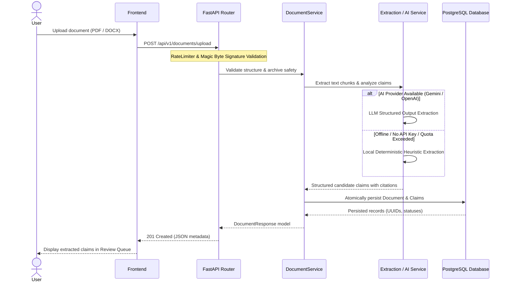

# Threadline Backend

The backend engine for Threadline, an AI-powered project knowledge continuity and handover platform. Built with Python 3.12, FastAPI, SQLAlchemy 2.0, Alembic, and Pydantic.

---

## Table of Contents

1. [Backend Purpose & Architecture](#backend-purpose--architecture)
2. [Request Lifecycle & Data Flow](#request-lifecycle--data-flow)
3. [Folder Structure](#folder-structure)
4. [Environment Setup & Installation](#environment-setup--installation)
5. [Dependencies](#dependencies)
6. [Environment Variables](#environment-variables)
7. [Database Connectivity & Engine Options](#database-connectivity--engine-options)
8. [Database Migrations (Alembic)](#database-migrations-alembic)
9. [Running the Application](#running-the-application)
10. [API Route Groups & Endpoints](#api-route-groups--endpoints)
11. [Document Extraction & AI Provider Fallback](#document-extraction--ai-provider-fallback)
12. [Security, Input Limits & Error Handling](#security-input-limits--error-handling)
13. [Automated Testing & Test Suites](#automated-testing--test-suites)

---

## Backend Purpose & Architecture

The Threadline backend provides a high-throughput, modular REST API that manages the knowledge continuity lifecycle:

- **Ingestion & Validation:** Safely validates and extracts technical documentation (PDF and DOCX) while defending against decompression bombs, malformed ZIP headers, and unconstrained memory allocations.
- **Context Extraction:** Analyzes document chunks via structured LLM APIs (Google Gemini or OpenAI) or falls back to an internal deterministic heuristic engine when offline.
- **Staging & Verification:** Manages candidate claims in a human-in-the-loop review queue, ensuring machine suggestions require human verification before being promoted to verified tasks or architectural decisions.
- **Relational Continuity Modeling:** Builds an in-memory graph using NetworkX to evaluate project connectivity, detect unlinked orphan nodes, and expose blocking paths.
- **Handover Synthesis:** Compiles project decisions, tasks, activity history, and risk registries into an 11-section executive handover report with PDF export capabilities.

The backend is structured as a modular monolith keeping database entities, schemas, domain services, and HTTP transport layers decoupled.

---

## Request Lifecycle & Data Flow



---

## Folder Structure

```text
backend/
├── alembic.ini                   # Alembic configuration file
├── requirements.txt              # Pinned Python dependencies
├── README.md                     # Backend technical guide
├── alembic/
│   ├── env.py                    # Dynamic database URL & metadata configuration
│   ├── script.py.mako            # Migration template
│   └── versions/
│       └── 28a2fd0b3a90_initial_schema.py # Complete database schema migration
├── app/
│   ├── main.py                   # ASGI application, CORS, rate limiter, routers, lifespan
│   ├── database.py               # SQLAlchemy engine, session maker, get_db, init_db
│   ├── api/
│   │   └── routes/               # API route handlers
│   │       ├── projects.py       # Project routes and nested tasks/decisions/timeline
│   │       ├── tasks.py          # Standalone task CRUD & filtering
│   │       ├── decisions.py      # Standalone decision (ADR) CRUD
│   │       ├── activities.py     # Global activity timeline
│   │       ├── documents.py      # Document upload, extraction, reprocessing
│   │       ├── reviews.py        # AI Review Queue approval/rejection endpoints
│   │       ├── continuity.py     # Relational knowledge continuity graph endpoints
│   │       └── reports.py        # Handover report generation, updates & PDF export
│   ├── core/
│   │   ├── config.py             # Pydantic Settings & environment variable parsing
│   │   └── rate_limiter.py       # Sliding-window rate limiting middleware
│   ├── models/                   # SQLAlchemy declarative ORM models
│   │   ├── project.py            # Project entity with cascading relationships
│   │   ├── task.py               # Task entity with status & priority enums
│   │   ├── decision.py           # Decision entity with rationale & decided_by
│   │   ├── activity.py           # Append-only activity log
│   │   ├── document.py           # Document metadata with deferred binary content
│   │   ├── extracted_knowledge.py# Categorized candidate knowledge claims
│   │   └── report.py             # Handover report with JSON section structure
│   ├── schemas/                  # Pydantic validation models with length limits
│   │   ├── project.py
│   │   ├── task.py
│   │   ├── decision.py
│   │   ├── activity.py
│   │   ├── document.py
│   │   ├── extracted_knowledge.py
│   │   ├── continuity.py
│   │   └── report.py
│   └── services/                 # Domain logic and external integrations
│       ├── project_service.py
│       ├── task_service.py
│       ├── decision_service.py
│       ├── activity_service.py
│       ├── document_service.py
│       ├── extraction_service.py # PyMuPDF & python-docx archive safety parser
│       ├── ai_service.py         # Gemini, OpenAI & deterministic fallback
│       ├── review_service.py     # Idempotent approvals & atomic promotion
│       ├── continuity_service.py # NetworkX graph builder & path analysis
│       └── report_service.py     # 11-section handover report synthesis
└── tests/                        # Pytest automated test suite (133 tests)
    ├── conftest.py               # In-memory SQLite fixtures & mock engines
    ├── test_projects.py
    ├── test_tasks.py
    ├── test_decisions.py
    ├── test_activities.py
    ├── test_documents_and_ai.py
    ├── test_rate_limiter.py
    ├── test_cors.py
    ├── test_migrations.py
    └── test_continuity_and_reports.py
```

---

## Environment Setup & Installation

### Windows PowerShell

```powershell
cd backend

# Create virtual environment
python -m venv .venv

# Activate virtual environment
.\.venv\Scripts\Activate.ps1

# Upgrade pip and install dependencies
pip install --upgrade pip
pip install -r requirements.txt
```

### macOS / Linux

```bash
cd backend
python3 -m venv .venv
source .venv/bin/activate
pip install --upgrade pip
pip install -r requirements.txt
```

---

## Dependencies

Key packages pinned in [`requirements.txt`](requirements.txt):

- **FastAPI (`0.162.2`) & Starlette (`1.10.0`):** Modern high-performance ASGI web framework.
- **SQLAlchemy (`2.1.8`):** SQL toolkit and Object Relational Mapper.
- **psycopg (`3.3.8`):** Modern, high-performance PostgreSQL driver for Python.
- **Alembic (`1.18.5`):** Database migration environment.
- **Pydantic (`2.14.3`) & Pydantic-Settings (`2.16.2`):** Data validation and environment management.
- **Uvicorn (`0.54.0`):** Lightning-fast ASGI web server implementation.
- **PyMuPDF (`2.1`):** High-speed PDF rendering and text extraction.
- **python-docx (`1.2.0`):** OpenXML Word document parsing.
- **NetworkX (`3.7`) & NumPy (`2.5.4`):** Graph data structures and topological analysis.
- **HTTPX (`0.28.1`):** Async and sync HTTP client for AI provider integration.
- **Pytest (`9.1.1`):** Test execution framework.

---

## Environment Variables

Configuration is loaded from environment variables or a `.env` file located in `backend/` or the repository root:

| Variable | Type | Default | Description |
| :--- | :--- | :--- | :--- |
| `DATABASE_URL` | String | `sqlite:///./threadline.db` | SQLAlchemy connection URL. Supports PostgreSQL (`postgresql+psycopg://...`) and SQLite (`sqlite:///...`). |
| `ENVIRONMENT` | String | `development` | Environment mode (`development`, `production`, `test`). |
| `FRONTEND_URL` | String | `http://localhost:5173` | Primary allowed origin for CORS requests. |
| `FRONTEND_URLS` | String | `None` | Comma-separated list of multiple allowed CORS origins for production. |
| `CORS_ALLOW_CREDENTIALS` | Boolean | `true` | Whether cookies/authorization headers are allowed (automatically disabled if wildcard `*` is used). |
| `API_V1_STR` | String | `/api/v1` | Prefix path for all version 1 REST routes. |
| `PROJECT_NAME` | String | `Threadline API` | Application title exposed in OpenAPI documentation. |
| `MAX_UPLOAD_SIZE_BYTES` | Integer | `52428800` (50 MB) | Maximum permitted file upload size. |
| `RATE_LIMIT_ENABLED` | Boolean | `true` | Toggle sliding-window rate limiting middleware. |
| `RATE_LIMIT_GENERAL` | Integer | `120` | Max requests per minute for standard API endpoints. |
| `RATE_LIMIT_EXPENSIVE` | Integer | `15` | Max requests per minute for AI and document processing endpoints. |
| `TRUSTED_PROXIES` | String | `""` | Comma-separated list of trusted upstream proxy IPs for `X-Forwarded-For` header evaluation. |
| `GEMINI_API_KEY` | String | `None` | Optional Google Gemini API key. |
| `OPENAI_API_KEY` | String | `None` | Optional OpenAI API key. |

---

## Database Connectivity & Engine Options

The database engine configuration in [`app/database.py`](app/database.py) includes safeguards:

- **Connection Pool Pre-Ping (`pool_pre_ping=True`):** Tests pooled connections on checkout with a lightweight ping (`SELECT 1`). Prevents `OperationalError` when remote poolers (such as Supabase Session Poolers or AWS RDS) terminate idle sockets.
- **Connection Recycling (`pool_recycle=300`):** Recycles pooled database connections every 5 minutes to prevent stale TCP sockets.
- **Driver Normalization:** `app/core/config.py` automatically normalizes legacy `postgresql://` and `postgres://` connection strings to `postgresql+psycopg://`.
- **Zero-Config Local Development:** If `DATABASE_URL` is unset, Threadline automatically defaults to a local file-based SQLite database (`sqlite:///./threadline.db`) with foreign keys enabled (`PRAGMA foreign_keys=ON;`).

---

## Database Migrations (Alembic)

Threadline uses Alembic to manage database schema evolution.

All migration commands must be run from the `backend/` working directory:

```powershell
cd backend
```

### Migration Commands

- **Upgrade to Head (Apply all pending migrations):**
  ```powershell
  python -m alembic upgrade head
  ```
- **Check Current Database Revision:**
  ```powershell
  python -m alembic current
  ```
- **View Migration History:**
  ```powershell
  python -m alembic history --verbose
  ```
- **Roll Back Last Revision:**
  ```powershell
  python -m alembic downgrade -1
  ```
- **Roll Back All Migrations to Base:**
  ```powershell
  python -m alembic downgrade base
  ```
- **Generate a New Migration (after editing ORM models):**
  ```powershell
  python -m alembic revision --autogenerate -m "describe_changes"
  ```

> [!NOTE]
> Alembic reads `settings.DATABASE_URL` dynamically from `app/core/config.py`. It never stores hardcoded credentials in `alembic.ini`. Both SQLite (with `render_as_batch=True`) and PostgreSQL are supported.

---

## Running the Application

### Local Development Server

Run Uvicorn with auto-reload from the `backend/` directory:

```powershell
cd backend
python -m uvicorn app.main:app --reload --host 127.0.0.1 --port 8000
```

Interactive documentation is available at:
- **Swagger UI:** `http://127.0.0.1:8000/docs`
- **ReDoc:** `http://127.0.0.1:8000/redoc`

---

## API Route Groups & Endpoints

All endpoints are mounted under `/api/v1`. Collection endpoints require a trailing slash (`/`), whereas resource-specific and action endpoints omit the trailing slash.

### 1. Projects (`/api/v1/projects`)
- `POST /api/v1/projects/` — Create project (`201 Created`).
- `GET /api/v1/projects/` — List all projects (`200 OK`, newest first).
- `GET /api/v1/projects/{id}` — Retrieve single project details.
- `PATCH /api/v1/projects/{id}` — Update project name, description, or status.
- `DELETE /api/v1/projects/{id}` — Delete project and cascade-delete all child records (`204 No Content`).
- `GET /api/v1/projects/{id}/timeline` — Retrieve chronological activity timeline for project.

### 2. Tasks (`/api/v1/tasks`)
- `POST /api/v1/tasks/` — Create task (`201 Created`).
- `GET /api/v1/tasks/` — List tasks (query filters: `project_id`, `status`, `priority`, `skip`, `limit`).
- `GET /api/v1/tasks/{id}` — Retrieve task details.
- `PATCH /api/v1/tasks/{id}` — Update task status, priority, or assignee.
- `DELETE /api/v1/tasks/{id}` — Delete task (`204 No Content`).
- `POST /api/v1/projects/{project_id}/tasks` — Create task directly under a project.
- `GET /api/v1/projects/{project_id}/tasks` — List tasks belonging to a specific project.

### 3. Decisions (`/api/v1/decisions`)
- `POST /api/v1/decisions/` — Record architecture decision record (`201 Created`).
- `GET /api/v1/decisions/` — List decisions (query filter: `project_id`).
- `GET /api/v1/decisions/{id}` — Retrieve decision details.
- `PATCH /api/v1/decisions/{id}` — Update decision rationale or decider.
- `DELETE /api/v1/decisions/{id}` — Delete decision (`204 No Content`).
- `POST /api/v1/projects/{project_id}/decisions` — Create decision nested under a project.
- `GET /api/v1/projects/{project_id}/decisions` — List decisions nested under a project.

### 4. Activities (`/api/v1/activities`)
- `GET /api/v1/activities/` — System-wide activity timeline (`order=asc|desc`, `limit`, `project_id`).

### 5. Documents (`/api/v1/documents`)
- `POST /api/v1/documents/upload` — Multipart file upload (supports `.pdf`, `.docx`). Validates magic bytes, extracts text, runs knowledge claims analysis, and persists record (`201 Created`).
- `GET /api/v1/documents/` — List document metadata (raw content is excluded via deferred column loading).
- `GET /api/v1/documents/{id}` — Retrieve document details.
- `POST /api/v1/documents/{id}/process` — Trigger re-processing on an existing document.
- `DELETE /api/v1/documents/{id}` — Delete document and associated claims (`204 No Content`).

### 6. AI Reviews (`/api/v1/reviews`)
- `GET /api/v1/reviews/` — List candidate extracted claims (`project_id`, `status`, `category`).
- `GET /api/v1/reviews/{id}` — Retrieve single claim details.
- `PATCH /api/v1/reviews/{id}/approve` — Idempotently approve claim and promote to Task or Decision.
- `PATCH /api/v1/reviews/{id}/reject` — Reject claim.
- `PATCH /api/v1/reviews/{id}/edit` — Edit claim title, content, or owner before approving.
- `POST /api/v1/reviews/approve-all` — Atomically approve all pending claims for a project.

### 7. Continuity Map (`/api/v1/continuity`)
- `GET /api/v1/continuity/graph` — Returns NetworkX relational graph (nodes, edges, orphan count, blocking paths).
- `GET /api/v1/continuity/summary` — Aggregate metric summary of continuity health.
- `GET /api/v1/continuity/nodes/{node_id}` — Inspect connected predecessors and successors.

### 8. Handover Reports (`/api/v1/reports`)
- `POST /api/v1/reports/generate` — Synthesize 11-section handover report JSON (`201 Created`).
- `GET /api/v1/reports/` — List generated reports.
- `GET /api/v1/reports/{id}` — Retrieve complete report JSON structure.
- `PATCH /api/v1/reports/{id}/successor` — Assign or update incoming successor name and role.
- `GET /api/v1/reports/{id}/pdf` — Export styled HTML view formatted for clean browser PDF printing.

---

## Document Extraction & AI Provider Fallback

The extraction pipeline in [`app/services/extraction_service.py`](app/services/extraction_service.py) and [`app/services/ai_service.py`](app/services/ai_service.py) operates deterministically:

1. **File Type Signature Verification:**
   - PDF files must begin with `%PDF-`.
   - DOCX files must start with `PK\x03\x04` and contain valid XML package structures.
2. **ZIP Decompression Bomb Protection:**
   - Archive entries capped at 1,000 items.
   - Total uncompressed size capped at 50 MB.
   - Individual entry size capped at 20 MB.
   - Compression ratio capped at 100:1.
   - Password-protected and encrypted entries rejected with HTTP 400.
3. **AI Knowledge Extraction Dispatched:**
   - If `GEMINI_API_KEY` is present: Calls Google Gemini API (`gemini-2.0-flash`) via `x-goog-api-key` header with structured JSON schemas.
   - If `OPENAI_API_KEY` is present: Calls OpenAI API (`gpt-4o-mini`) via bearer token authentication.
   - **Offline Deterministic Fallback:** If neither API key is set, or if network connectivity or provider rate limits fail, Threadline automatically switches to a local heuristic extraction engine. This engine extracts tasks, decisions, risks, questions, and page citations using regex pattern matching and structural sentence analysis.

---

## Security, Input Limits & Error Handling

- **Rate Limiting:** Protects endpoints using an in-memory sliding window limiter:
  - 120 requests/minute for general endpoints.
  - 15 requests/minute for expensive endpoints (document upload, reprocessing, batch approvals, report generation).
  - Returns `429 Too Many Requests` with `Retry-After` headers.
- **CORS Hardening:** Rejects wildcards (`*`) in production and forbids combining wildcards with `allow_credentials=True`. Supports comma-separated origin whitelists via `FRONTEND_URLS`.
- **Credential Redaction in Logs:** Logs automatically scrub API keys, tokens, authorization headers, and raw database connection strings before writing to server stdout.
- **Pydantic Field Constraints:**
  - Names and titles: 1 to 200 characters.
  - Short labels, status, owner: 1 to 100 characters.
  - Descriptions, rationales: up to 10,000 characters.
  - Activity descriptions: up to 2,000 characters.
  - Filenames: up to 255 characters.

---

## Automated Testing & Test Suites

The backend maintains 133 automated tests using Pytest against isolated SQLite in-memory databases (`sqlite:///:memory:` with `StaticPool`).

### Running Tests

From the `backend/` directory:

```powershell
cd backend
python -m pytest tests -v
```

Or from the repository root:

```powershell
npm run test:backend
```

### Test Suite Breakdown

| Suite | File | Tests | Coverage Scope |
| :--- | :--- | :---: | :--- |
| **Activities** | `test_activities.py` | 10 | Lifecycle triggers, status changes, idempotent updates, timeline order, cascade deletions. |
| **Continuity & Reports** | `test_continuity_and_reports.py` | 17 | Continuity graph construction, orphan nodes, blocking paths, 11-section report generation, successor assignment, PDF styling. |
| **CORS Security** | `test_cors.py` | 8 | Origin whitelisting, wildcard rejection in production, preflight OPTIONS, rate limit header retention. |
| **Decisions** | `test_decisions.py` | 14 | Architecture decisions CRUD, validation boundaries, rationale limits, 404 handling. |
| **Documents & AI** | `test_documents_and_ai.py` | 27 | File signature validation, DOCX zip-bomb protection, credential sanitization in logs, recoverable error states, deferred loading. |
| **Migrations** | `test_migrations.py` | 5 | Alembic upgrade/downgrade cycle, fresh database creation, SQLite foreign key enforcement, CLI execution from backend working directory. |
| **Projects** | `test_projects.py` | 15 | Project CRUD, cascade deletions of child entities, engine connection pool options. |
| **Rate Limiter** | `test_rate_limiter.py` | 6 | Sliding window limits, 429 Retry-After responses, client IP isolation, trusted proxy evaluation. |
| **Tasks** | `test_tasks.py` | 31 | Task CRUD, status/priority filtering, nested routes, assignee size limits, 404s. |
| **Total** | | **133** | **133 Passed, 0 Failed** |
